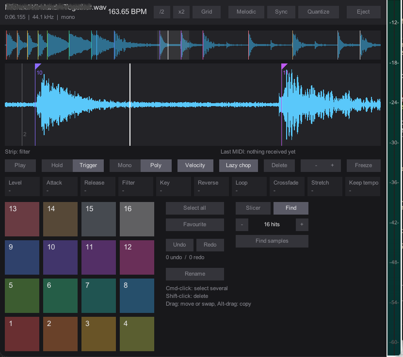

# ReaFlip

[](https://github.com/christian-frei/reaFlip/releases/latest)
[](LICENSE)


A sample-chopping instrument for REAPER. Load one audio section, set 16 cues
on 16 pads, and play them from the window or a MIDI controller. Beatgrid,
auto-slicing, per-cue shaping and time stretch are built in. It is one JSFX
plus one Lua action, with no extensions.



Modelled on the Serato Sample workflow and tested with the AlphaTheta SLAB in
General MIDI mode. Not affiliated with or endorsed by Serato or AlphaTheta.

## Features

| | |
|---|---|
| **Load** | The selected item's visible section, straight from the file. The source file is only read, never changed. |
| **Chop** | Lazy chop while the source plays, draggable start/end handles, Quantize to 1/8 beat. |
| **Auto set** | **Slicer**: equal slices of 1/16–16 beats. **Find**: cues on the 4–16 loudest hits, placed on zero crossings. |
| **Beatgrid** | Tempo and downbeat are detected on load. Double, halve, tap, or drag the grid by hand. |
| **Shape** | Per cue: level, attack, release, filter, key, reverse, loop mode, crossfade. |
| **Stretch** | Sync to the project tempo, 0.25–4× per cue, key shift that keeps the tempo. Two engines: **Drums** (WSOLA) and **Melodic** (phase vocoder). |
| **Organise** | Multi-select, favourites, move, swap, copy, rename, undo/redo. |
| **Controller** | MIDI Learn for pads, dial, encoders, buttons and touch strip. The map is shared by all instances. |

## Prerequisites

REAPER 7.x (stock). No SWS, js_ReaScriptAPI or ReaImGui. ReaPack is
optional, for installing and updating.

## Install

### With ReaPack

1. In REAPER, open *Extensions → ReaPack → Import repositories…* and paste:
   ```
   https://github.com/christian-frei/reaFlip/raw/main/index.xml
   ```
2. Open *Extensions → ReaPack → Browse packages*, find **ReaFlip**, and
   install it. This installs the JSFX and registers the load action
   **ReaFlip_Load**. Bind the action to a key or toolbar button.

### By hand

1. Download the zip from the [latest release](https://github.com/christian-frei/reaFlip/releases/latest).
2. In REAPER, open *Options → Show REAPER resource path*.
3. Copy `ReaFlip.jsfx` into `Effects/` and `ReaFlip_Load.lua` into `Scripts/`.
4. Open *Actions → New action → Load ReaScript…*, pick `ReaFlip_Load.lua`,
   and bind it to a key or toolbar button.

## Use

1. **Load.** Select one audio item (WAV or AIFF, mono or stereo) and run
   **ReaFlip_Load**.
   - Only the item's visible section loads.
   - Without a ReaFlip instance, the action creates a track below the item's
     track. The track is armed and monitors all MIDI inputs.
   - With several instances, the last-focused open window wins.
2. **Grid.** On load, ReaFlip detects tempo and downbeat.
   - Cancel the analysis, or halve or double the BPM.
   - To fix it, open **Grid** edit: drag markers, Alt-drag to slide, type a
     BPM, tap, set the start, or use the metronome.
3. **Cues.**
   - **Lazy chop**: hit empty pads while the source plays. Each hit drops a
     cue.
   - **Auto set**: Slicer or Find (see Features). Favourite pads are kept.
   - Drag the start and end handles in the main waveform.
4. **Shape.** Edit the selected cues in the parameter row.
   - Drag up or down; Cmd/Ctrl-drag gives fine steps.
   - Alt-click resets a value.
5. **Stretch.**
   - **Sync** stretches everything to the project tempo.
   - **Drums / Melodic** picks the engine. When nothing is stretched, no
     engine runs.

### Pads

| Action | Result |
|---|---|
| Click | Play |
| Shift-click | Delete |
| Cmd/Ctrl-click | Add to or remove from the selection |
| Drag | Move or swap |
| Alt-drag | Copy |

The project saves the source path, section, cues, grid and MIDI map. If the
file is moved or renamed, ReaFlip shows a message and keeps all cues.

## MIDI controller

Pick the controller under **MIDI controller** next to the pads:

| Entry | Assignment |
|---|---|
| **AlphaTheta SLAB** (default) | Every control in the table below, ready to play |
| **Pads only** | Notes 0–15 on any channel as pads 1–16 |
| **Learned** | Your last confirmed **Learn** run |

For any other controller, run **Learn**:

- The window walks through each control: pads, dial, Shift, Delete, arrows,
  encoders, buttons.
- It detects the dial and encoder encoding by itself.
- Skip optional steps, then confirm.

The confirmed map becomes the **Learned** entry in every instance. It
survives a REAPER restart once the load action has run.

### SLAB setup

1. Hold **ENCODER MODE** to switch the SLAB to General MIDI mode.
2. In *Preferences → Audio → MIDI Inputs*, right-click the SLAB and choose
   **Enable input**. "Control messages only" is not enough.

New instances use the SLAB preset; no Learn needed. The touch strip
responds in the SLAB's strip mode 2 (press STRIP MODE on the unit if it does
not react).

| SLAB control | Function |
|---|---|
| Dial / Shift + dial | Move the selected cue's start / end |
| Dial press, PLAY | Play / pause the source |
| Left / right arrow | Move the selected cue's end one beat earlier / later |
| Encoders 1–4 | Level, filter, attack, key (press resets) |
| DELETE / DELETE + pad | Delete the selected cues / that pad |
| AUTO SET / Shift + AUTO SET | Run auto set / switch Slicer and Find |
| FAVORITE / Shift + FAVORITE | Toggle favourite / switch Mono and Poly |
| SELECT ALL / Shift + SELECT ALL | Select or clear all / toggle Quantize |
| TRIGGER MODE | Switch Hold and Trigger |
| NOTE REPEAT | Next loop mode |
| STRIP MODE + touch strip | Filter, pad level or loop crossfade |
| UNDO / REDO | Undo / redo |

The SLAB's pad and button LEDs are not driven yet.

## Limits

- WAV and AIFF only, mono or stereo.
- At most 18 s of 44.1 kHz stereo per load. That is 36 s for mono, and less
  at higher sample rates.
- One tempo per source, 4/4, 20–220 BPM.

## Licence

MIT, see [LICENSE](LICENSE).
